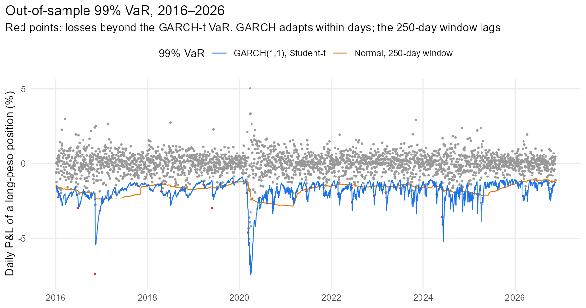

# Mexican rates and the peso: factors, regimes and tail risk

**What moves the Mexican yield curve, whether its moves are normal, and which Value-at-Risk model survives ten years of out-of-sample backtesting on the peso.**

📊 [Full report](https://amaugomez.github.io/mexican-rates-risk/) · R (mclust, MVN, rugarch) · Data: [Banco de México, SIE](https://www.banxico.org.mx/SieAPIRest/service/v1)

---

## The answers

| Question | Answer |
|---|---|
| What moves the curve? | Three factors explain 93.8% of quarterly changes at nine maturities (2006–2026): **level 70.1%**, **slope 20.2%**, **curvature 3.6%** (SVD / principal components) |
| Are the moves normal? | **No.** Mardia and Henze–Zirkler reject multivariate normality; 5 of 79 quarters lie beyond the 99% χ² quantile, where about 1 would be expected |
| Are there regimes? | **Not detectable in 79 quarters** (BIC chooses one component). **In daily peso moves, yes:** BIC chooses three, and a stress regime (~5% of days, ~2% daily volatility) concentrates in 2020, 2008 and 2016 |
| Which 99% VaR model works for the peso? | Over 2,736 out-of-sample days (2016–2026), **only GARCH(1,1) with Student-t errors** passes Kupiec and Christoffersen: 37 exceptions vs 27 expected. A normal model had 66, bunched in crises |



## Why each step

1. **SVD of centred quarterly changes** finds the directions in which the whole curve moves; it is identical to principal components (eigenvalues = d²/(n−1)), checked in the code.
2. **Normality tests and a χ² Q-Q plot of Mahalanobis distances**, because most textbook risk models assume normal changes.
3. **Gaussian mixtures chosen by BIC** (model-based clustering) test whether heavy tails come from a mixture of calm and stressed periods. The negative result on quarterly data is reported as such.
4. **GARCH(1,1)** because squared peso returns are strongly autocorrelated (Ljung–Box, ARCH LM); **Student-t errors** because standardised shocks still have heavy tails (log-likelihood +135).
5. **Out-of-sample backtesting with Kupiec and Christoffersen** against normal and historical-simulation benchmarks, because a VaR model must get both the frequency and the timing of its exceptions right.

## Reproduce it

```r
Rscript run_all.R   # about 2 minutes
```

| Script | What it does |
|---|---|
| `R/01_get_data.R` | Downloads the series from Banxico's SIE API (only if `BANXICO_TOKEN` is set; the processed data are already in `data/`) |
| `R/02_curve_factors.R` | Quarterly curve, SVD / principal components, loadings |
| `R/03_normality.R` | Mardia, Henze–Zirkler, Mahalanobis Q-Q |
| `R/04_regimes.R` | Gaussian mixtures with `mclust` on the curve factors and on daily peso moves |
| `R/05_fx_garch_var.R` | Stylised facts, GARCH fits, rolling 99% VaR and backtests |

**Data:** Banco de México, Sistema de Información Económica (SIE): monthly average yields of Cetes and fixed-rate Bonos M (series SF4830, SF3338, SF3270, SF3367, SF17990, SF18608, SF33229, SF30057, SF41841, SF60719) and the daily FIX exchange rate (SF43718). Reproduced citing the source, as Banco de México requires: [banxico.org.mx](https://www.banxico.org.mx).

## Skills shown

Singular value decomposition and principal components · multivariate normality · model-based clustering (Gaussian mixtures, BIC) · GARCH volatility models · Value at Risk and backtesting (Kupiec, Christoffersen) · market risk · R · Quarto

---

Code: MIT License. Aaron Mauricio Gómez Jiménez · [LinkedIn](https://www.linkedin.com/in/amaugomezjimenez) · [ORCID](https://orcid.org/0009-0003-1099-0431)
