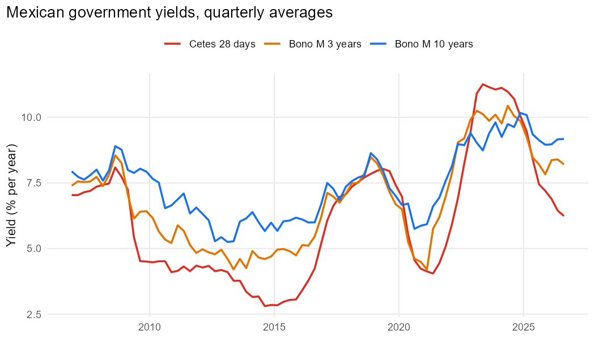
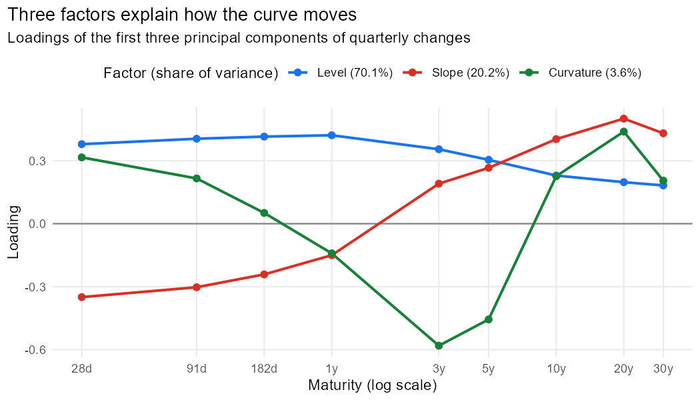
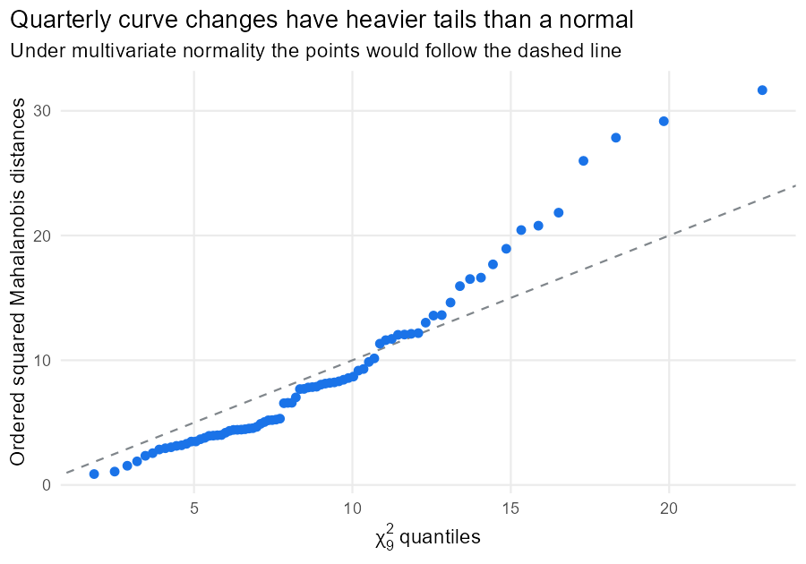
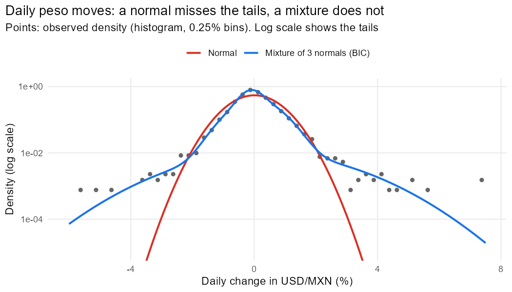
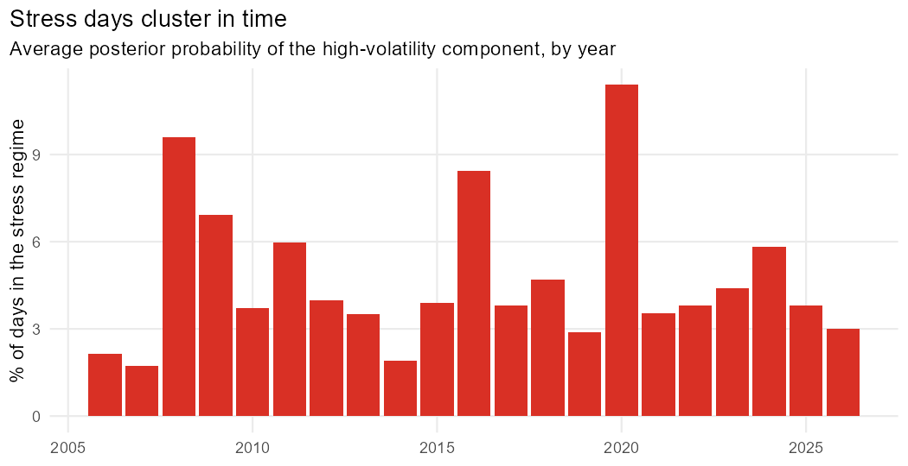
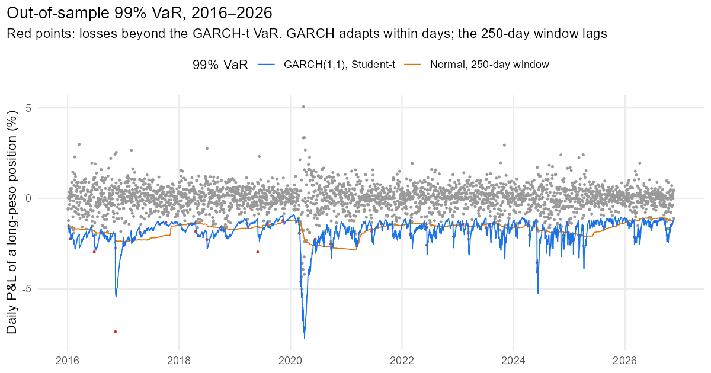
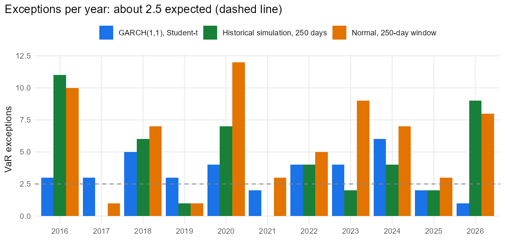

```{r}
r <- function(f) read.csv(file.path("results", paste0(f, ".csv")))
cs <- r("curve_summary"); ld <- r("curve_loadings"); nt <- r("normality_tests"); ns <- r("normality_summary")
rq <- r("regimes_quarterly"); rc <- r("regimes_fx_components"); ry <- r("regimes_fx_by_year")
fx <- r("fx_facts"); gf <- r("garch_fit"); bt <- r("var_backtest"); ey <- r("var_exceptions_by_year")
pct <- function(x, d = 1) formatC(100 * x, format = "f", digits = d)
f2 <- function(x, d = 2) formatC(x, format = "f", digits = d)
gt <- gf[gf$model == "GARCH-t", ]
bgt <- bt[grepl("Student", bt$model), ]; bno <- bt[grepl("^Normal", bt$model), ]; bhs <- bt[grepl("250 days", bt$model), ]
top <- ry[order(-ry$stress_share), ][1:3, ]
stress <- rc[rc$regime == "Stress", ]
```

**November 2026** · R (mclust, MVN, rugarch) · [Code](https://github.com/AMauGomez/mexican-rates-risk) · Data: [Banco de México, Sistema de Información Económica (SIE)](https://www.banxico.org.mx/SieAPIRest/service/v1)

::: {.callout-note appearance="minimal"}
**In one paragraph.** Three factors (level, slope and curvature) explain `r pct(cs$share_change_1 + cs$share_change_2 + cs$share_change_3)`% of how the Mexican government yield curve moves from quarter to quarter. Those moves are not multivariate normal: their tails are heavier. Daily moves of the peso are far from normal too (excess kurtosis `r f2(fx$excess_kurtosis, 1)`), and their volatility comes in waves. Over `r format(bgt$days, big.mark = ",")` trading days of out-of-sample backtesting (2016–2026), only a **GARCH(1,1) model with Student-t errors** produces a 99% Value at Risk with the right number of exceptions, spread over time as they should be. A normal model, the kind still found in simple risk reports, was breached `r bno$exceptions` times instead of `r round(bno$expected)`.
:::

## The data

- **Yield curve.** Monthly average yields of Mexican government securities at nine maturities: Cetes at 28, 91, 182 and 364 days and fixed-rate Bonos M at 3, 5, 10, 20 and 30 years (SIE series SF4830, SF3338, SF3270, SF3367, SF17990, SF18608, SF30057, SF41841, SF60719), from `r cs$first_q` (the first quarter with a 30-year bond) to `r cs$last_q`.
- **Peso.** The daily FIX exchange rate, pesos per US dollar (SIE series SF43718): `r format(fx$n, big.mark = ",")` daily changes from `r fx$first` to `r fx$last`.

Banco de México does not publish a free daily secondary-market curve; those curves come from private price vendors. Long bonds are auctioned every few weeks, so the monthly series have gaps. **Quarterly averages** fill almost all of them: only `r cs$missing_cells` of `r cs$total_cells` cells are missing, and those are interpolated in time, tenor by tenor.

Data reproduced citing the source, as Banco de México requires.

## A. What moves the curve: three factors

```{r}
#| out-width: 100%

```

Yields ranged from `r f2(cs$min_rate)`% to `r f2(cs$max_rate)`% over twenty years. To find *how* the curve moves, I take quarterly changes at the nine maturities, centre them and compute their **singular value decomposition** $X = UDV^\top$. The columns of $V$ are the directions in which the curve moves; $d_k^2 / \sum_j d_j^2$ is the share of variance each one explains. The SVD of the centred data matrix and the principal components of its covariance matrix are the same thing (the eigenvalues are $d_k^2/(n-1)$), which the code checks.

```{r}
#| out-width: 100%

```

| Factor | Share of variance | What it does |
|---|---|---|
| **Level** | `r pct(cs$share_change_1)`% | All yields move in the same direction. Short rates move more (loading `r f2(ld$Level[1])` at 28 days against `r f2(ld$Level[9])` at 30 years), consistent with a curve whose short end follows the policy rate closely. |
| **Slope** | `r pct(cs$share_change_2)`% | Short rates and long rates move in opposite directions: the curve steepens or flattens. |
| **Curvature** | `r pct(cs$share_change_3)`% | The 3- to 5-year segment moves against both ends. |

This is the classic level–slope–curvature result found in yield curves across countries, here for Mexico. In **levels** rather than changes, the first factor alone explains `r pct(cs$share_level_1)`%: yields at all maturities rise and fall together over the cycle.

**Why it matters for risk.** A portfolio of bonds at many maturities has nine risk drivers, but three numbers describe almost all of its exposure. Stress tests and hedging are built on these factors.

## B. Are the moves normal?

Many risk models assume that changes are multivariate normal. Under that assumption, squared Mahalanobis distances of the changes follow a $\chi^2_9$ distribution.

```{r}
#| out-width: 80%

```

```{r}
knitr::kable(nt, digits = 3, col.names = c("Data", "Test", "Statistic", "p-value"))
```

Normality is rejected by Mardia's skewness and kurtosis tests and by Henze–Zirkler, both for the nine maturities and for the three factors. `r ns$n_above_q99` of `r ns$n` quarters lie beyond the 99% quantile of the $\chi^2_9$, where about `r f2(ns$expected_above, 1)` would be expected. Caution: with `r ns$n` quarters and 9 variables, the asymptotic versions of these tests are approximate, but the plot tells the same story without relying on them.

## C. Are there regimes? Gaussian mixtures

A mixture of normal distributions can produce heavy tails: most of the time data come from a calm component and occasionally from a volatile one. **Model-based clustering** fits mixtures with 1 to 4 components (and several covariance structures) and chooses by BIC, which penalises extra parameters.

**On the quarterly curve, BIC chooses a single component** (model `r rq$model`). With `r rq$n` quarters, the data cannot distinguish separate regimes from one distribution with somewhat heavy tails: a second component costs more parameters than it buys in fit. It is a useful negative result: regimes need either more data or a higher frequency.

**On the daily peso, BIC chooses `r nrow(rc)` components**:

```{r}
knitr::kable(data.frame(Regime = rc$regime, `Share of days` = paste0(pct(rc$share), "%"),
                        `Daily volatility` = paste0(f2(rc$sd), "%"), check.names = FALSE),
             align = "lrr")
```

```{r}
#| out-width: 100%

```

The stress component covers about `r pct(stress$share)`% of days but has a volatility of about `r f2(stress$sd, 1)`% a day, several times the calm one. It is what produces the tails a single normal cannot.

```{r}
#| out-width: 100%

```

The years with the most stress days are `r top$year[1]`, `r top$year[2]` and `r top$year[3]`, the years of the COVID-19 shock, the global financial crisis and the US election of 2016 (the largest one-day depreciation of the peso in the sample, `r f2(fx$max)`%, is on `r fx$max_date`). The dates coincide; the data alone do not prove the causes. **Stress days come in clusters**, which a mixture of independent draws ignores. That is the job of a GARCH model.

## D. Volatility of the peso and Value at Risk

**The stylised facts.** Daily changes of USD/MXN have a standard deviation of `r f2(fx$sd)`% and an excess kurtosis of `r f2(fx$excess_kurtosis, 1)`. Squared changes are strongly autocorrelated (Ljung–Box on squared changes, 10 lags: statistic `r format(round(fx$lb_sq_stat), big.mark = ",")`; Engle's ARCH LM test: `r format(round(fx$arch_stat), big.mark = ",")`, both with p-values that are zero to many decimal places): **calm days follow calm days and turbulent days follow turbulent days**.

**GARCH(1,1).** The conditional variance today depends on yesterday's surprise and yesterday's variance:

$$
\sigma_t^2 = \omega + \alpha\,\varepsilon_{t-1}^2 + \beta\,\sigma_{t-1}^2 .
$$

```{r}
knitr::kable(data.frame(Model = gf$model, `Log-likelihood` = round(gf$loglik, 1),
                        alpha = f2(gf$alpha, 3), beta = f2(gf$beta, 3),
                        `Persistence (α+β)` = f2(gf$persistence, 3),
                        `Half-life (days)` = round(gf$half_life_days),
                        `t degrees of freedom` = ifelse(is.na(gf$df), "", f2(gf$df, 1)), check.names = FALSE))
```

Persistence of `r f2(gt$persistence, 3)` means a volatility shock fades slowly: half of it is gone after about `r round(gt$half_life_days)` trading days. Student-t errors with about `r round(gt$df)` degrees of freedom improve the log-likelihood by `r round(gt$loglik - gf$loglik[1])` points: even after modelling the changing volatility, the standardised shocks have heavy tails.

### Backtesting the 99% one-day VaR, 2016–2026

**Position:** an investor long Mexican pesos, who loses when the peso depreciates. Each model forecasts tomorrow's 1% quantile of the profit and loss using only past data: rolling windows for the normal and historical-simulation models; GARCH refitted every 50 days on the previous 1,500 days. Two tests:

- **Kupiec (unconditional coverage):** is the share of exceptions 1%?
- **Christoffersen (conditional coverage):** is it 1% *and* are exceptions independent, not bunched in crises?

```{r}
knitr::kable(data.frame(Model = bt$model, Exceptions = bt$exceptions, Expected = round(bt$expected),
                        Rate = paste0(f2(100 * bt$rate), "%"),
                        `Kupiec p` = formatC(bt$kupiec_p, format = "g", digits = 2),
                        `Christoffersen p` = formatC(bt$christoffersen_p, format = "g", digits = 2),
                        check.names = FALSE), align = "lrrrrr")
```

```{r}
#| out-width: 100%

```

```{r}
#| out-width: 100%

```

- **The normal model fails twice:** too many exceptions (`r f2(100 * bno$rate, 1)`% instead of 1%) and bunched in turbulent years (`r ey$normal[ey$year == 2016]` in 2016 and `r ey$normal[ey$year == 2020]` in 2020). A 250-day window reacts to a crisis months after it starts.
- **Historical simulation** does better on the count but still fails both tests: it has no notion that volatility changes.
- **GARCH with normal errors** adapts its volatility within days, but its tails are too thin: `r bt$exceptions[grepl("normal errors", bt$model)]` exceptions.
- **GARCH with Student-t errors is the only model that passes both tests** (Kupiec p = `r f2(bgt$kupiec_p)`, Christoffersen p = `r f2(bgt$christoffersen_p)`), with exceptions spread over the years (between `r min(ey$garch_t)` and `r max(ey$garch_t)` a year). It is still slightly above 1% (`r f2(100 * bgt$rate, 2)`%), so a validator would keep it under monitoring.

**The lesson.** A VaR model needs two ingredients: **volatility that changes over time** (GARCH) and **heavy tails** (Student-t). Each alone fails. This is the same distinction as in credit models: one model can be right on average and wrong exactly when it matters.

## What a validator would ask

- **Quarterly curve data.** Averages of auction yields smooth the daily moves, and a few cells are interpolated. A trading desk would use a daily curve from a price vendor.
- **Exchange rate only.** A full market-risk model would combine the peso with the rate factors of part A in a multivariate model (for example, a multivariate GARCH or a factor copula).
- **Regimes.** The mixture ignores the order of the days. A Markov-switching model would estimate regimes that persist over time, the natural next step after part C.
- **One position, one horizon.** Regulatory VaR uses 10-day horizons and Expected Shortfall (Basel's FRTB uses ES at 97.5%); the same backtesting logic extends to them.

## Reproduce it

```r
Rscript run_all.R   # about 2 minutes
```

The processed data are in `data/`, so the analysis runs without credentials. To refresh them from the SIE API, request a free token from Banco de México and set the environment variable `BANXICO_TOKEN` (see `R/01_get_data.R`).

This project also covers three topics of the Multivariate Analysis course I assist at UNAM: the singular value decomposition, the multivariate normal distribution and model-based clustering.

---

Code: MIT License · Data: Banco de México, Sistema de Información Económica (SIE), [banxico.org.mx](https://www.banxico.org.mx). Aaron Mauricio Gómez Jiménez · [LinkedIn](https://www.linkedin.com/in/amaugomezjimenez) · [GitHub](https://github.com/AMauGomez)
